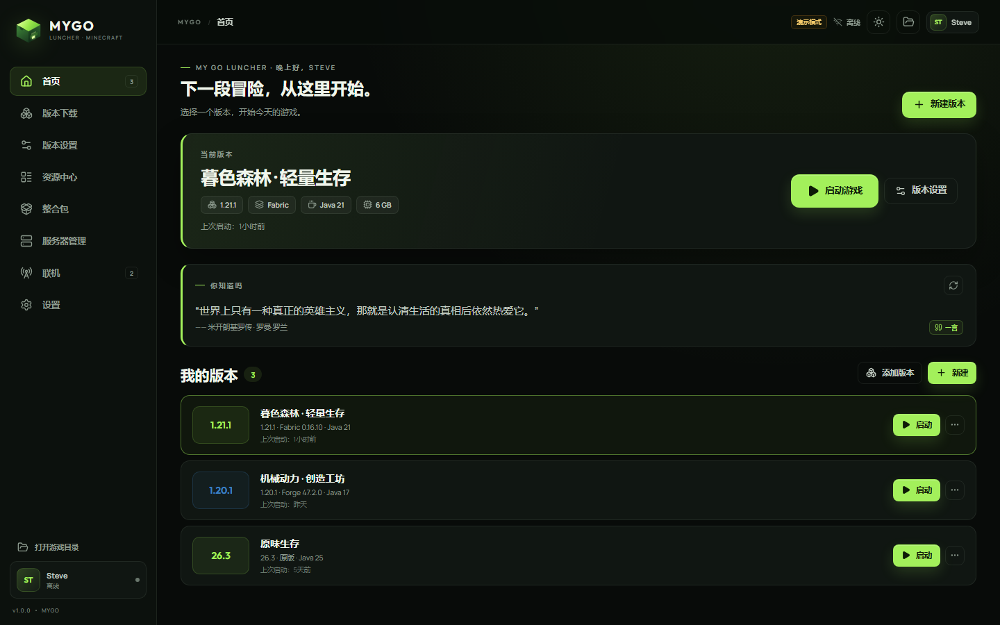
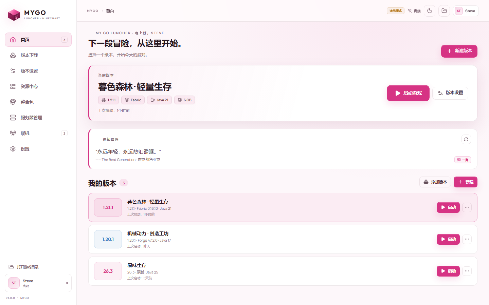
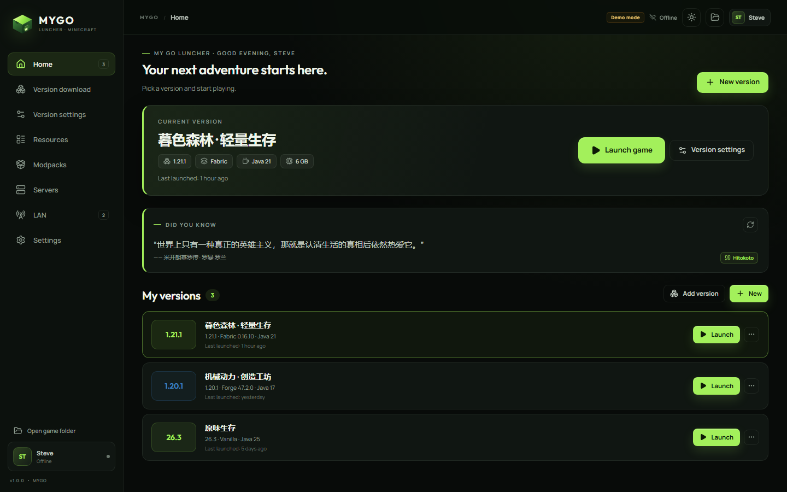

# MyMinecraftGoLuncher（MyGoLuncher）

[](https://www.orcarouter.ai/ref/ref_00ee071bfd29fc8bb954)

一个使用 **Go + Wails + React + TypeScript** 构建的 Minecraft 桌面启动器。

界面保持简洁，同时提供版本设置、资源中心、整合包与 Java 运行时管理。支持黑夜 / 白天两种主题，白天模式以粉色为主色。







## 功能

- **添加本地版本**：扫描本机官方启动器、HMCL、PCL2、Prism Launcher / MultiMC，也可以手动选择 `.minecraft`、`versions` 目录或单个版本文件夹。支持一次勾选多个版本批量导入；「自定义导入」可手动填写版本名称、Minecraft 版本、加载器与可选的来源目录，并支持递归搜索指定目录下的 `.minecraft` / `versions` 文件夹、自动识别版本并填入信息。导入时复制存档、模组、资源包与配置，并准备游戏运行环境。
- **下载官方版本**：从 Mojang 元数据获取正式版、快照和远古版本，下载客户端、运行库、本地库与资源文件。
- **多下载源**：官方源与 BMCLAPI，安装前测速并自动回退，所有文件仍做哈希校验。
- **版本设置**：在左侧「版本设置」中统一管理已安装版本，可修改名称、内存与 Java，查看游戏目录。
- **版本隔离**：可在设置中开启或关闭。开启时每个版本拥有独立的 `mods/`、`shaderpacks/`、`resourcepacks/`、`saves/` 与日志目录；关闭后所有版本共用 `.minecraft`。
- **加载器**：Fabric、Quilt、Forge、NeoForge。
- **资源中心**：从 Modrinth 与 CurseForge 搜索并安装模组、光影、资源包、数据包与整合包；可在设置中填写 CurseForge API Key。
  - 内置常见中文别名（如“钠”“小地图”“苹果皮”），无需 AI 也可搜索。
  - 可选接入 AI 搜索：默认使用 **DeepSeek**（`deepseek-chat`），也支持 **Anthropic Claude** 与 **OrcaRouter**（`orcarouter/auto`，Responses API）；在「设置 → AI 搜索」中选择提供商并填写 API Key。
  - OrcaRouter 支持 PKCE 一键授权：在系统浏览器中确认后自动获取并加密保存 API Key。
- **整合包与服务器包**：
  - 导入 `.mrpack`、CurseForge `.zip`、Prism / MultiMC 或通用 `.zip`。
  - 一键导出 `.mrpack` 或完整备份 `.zip`。
  - 一键导出服务器包 `.zip`：包含加载器运行时或安装器、`mods/`、`config/`、`defaultconfigs/`、`scripts/`、`kubejs/`、`datapacks/`、`server.properties`、启动脚本与 EULA 模板。
- **服务器管理（MCSM）**：添加多个 MCSManager 面板与实例，绑定本地版本后，把 `mods/`、`config/`、`defaultconfigs/`、`scripts/`、`kubejs/`、`datapacks/`、`resourcepacks/`、`shaderpacks/` 增量同步到服务器；支持远程启动、停止、重启与可选删除远端多余文件。
- **局域网联机**：启动后自动发现同一局域网内使用本启动器的其他客户端（侧边栏显示数量），并自动发现「对局域网开放」的 Minecraft 世界和局域网服务器，显示版本、MOTD 与在线玩家。选择本地版本即可一键直连，也支持手动输入地址。
- **局域网版本同步**：可把本地版本的 `mods/`、`shaderpacks/`、`resourcepacks/`、`config/` 共享给同一局域网的其他客户端；对方在联机页选择匹配的本地版本即可增量同步，SHA-256 校验，只下载缺失或变化的文件。
- **账户**：
  - Microsoft 正版登录（设备码 OAuth）。
  - 外置登录，内置 **LittleSkin**（`https://littleskin.cn/api/yggdrasil`）与 **YggdrasilSkinServer**（`https://yss.1v.fit`），也兼容其他 Authlib-Injector 服务器。
  - **YSS 一键授权**：选择 YggdrasilSkinServer 后可使用 OAuth2 设备码流程，在系统浏览器中登录并确认，无需输入站点密码。需要在 YSS 管理端启用「启动器 OAuth2」。
  - 离线账户，可添加、重命名和切换。
- **Java**：自动扫描本机 Java，按版本元数据匹配；缺失时从 Adoptium 下载 Temurin JRE。
- **游戏控制台**：实时日志、错误高亮、复制日志、结束游戏进程。
- **启动动画**：点击启动后显示旋转方块与进度动画；检测到游戏窗口出现后动画结束。
- **游戏语言同步**：启动游戏前将 Minecraft 语言设置为启动器当前界面语言（`zh_cn` / `zh_tw` / `en_us` / `ja_jp` / `ko_kr`），写入实例的 `options.txt`。
- **启动后隐藏**：检测到游戏窗口真正出现后才隐藏启动器；游戏窗口关闭（进程退出）后自动恢复启动器窗口。可在设置中关闭。
- **主题**：黑夜模式（荧光绿）/ 白天模式（粉色），主题保存在本机。
- **多语言**：简体中文、繁體中文、English、日本語、한국어。默认跟随系统语言，无法识别时回退简体中文；可在设置中关闭自动跟随并固定启动语言。
- **内置窗口控制**：隐藏系统标题栏，顶部栏可拖动窗口，并提供最小化、最大化 / 还原和关闭按钮。
- **首页“你知道吗”**：默认从 HitokotoGo 获取一句“一言”，地址为 `https://hitokotogo.yhdzz.cn/v2`，可在设置中更换。接口文档：<https://hitokotogo.yhdzz.cn/docs>。

## 技术栈

| 层 | 技术 |
| --- | --- |
| 桌面壳 | Wails v2.17 |
| 后端 | Go 1.25+ |
| 前端 | React 19 + TypeScript + Vite |
| 图标 | Lucide |
| 数据源 | Mojang Piston Meta、Adoptium API、Fabric / Quilt Meta、Forge / NeoForge 官方 Maven、Modrinth API、CurseForge API |

## 开发

### 依赖

- Go 1.25 或更高版本
- Node.js 20 或更高版本
- Wails CLI v2.17

```bash
go install github.com/wailsapp/wails/v2/cmd/wails@v2.17.0
```

### 运行

```bash
cd frontend
npm install
cd ..
wails dev
```

### 构建

```bash
wails build
```

构建产物位于 `build/bin/`。Windows 可执行文件名为 `MyMinecraftGoLuncher.exe`。

仅调试前端界面时：

```bash
cd frontend
npm run dev
```

浏览器中会启用演示模式，后端 API 由 `src/lib/mock.ts` 提供模拟数据。

### 测试

```bash
go test ./...
go vet ./...
cd frontend && npm run build
```

## 便携目录

所有数据都与可执行文件放在同一目录，移动整个文件夹即可迁移：

```text
<程序所在目录>/
├── MyMinecraftGoLuncher.exe
├── .minecraft/          # 游戏下载、版本与实例数据
└── MGL/                 # 仅存放非敏感配置
    ├── instances.json
    ├── servers.json     # MCSM 服务器绑定（不含 API Key）
    ├── settings.json
    └── cache/
```

> 程序目录必须可写。若放在 `Program Files` 等受保护目录，启动器将无法创建上述目录。
>
> 本地版本支持多选批量导入；未被扫描器识别的版本可使用「自定义导入」，手动填写 Minecraft 版本、加载器与来源目录，或选择包含 `.minecraft` / `versions` 的父目录后搜索并识别版本。
>
> 可用环境变量 `MGL_HOME` 覆盖基础目录，`MYGOLUNCHER_HOME` 作为兼容别名。
>
> 旧版本使用过的 `MyGoLuncher` 临时配置目录会在首次启动时自动迁移回 `MGL`。

## 安全存储

账户、Microsoft/Yggdrasil 令牌、外置登录令牌、CurseForge API Key、AI API Key 与 MCSM API Key 不再写入 `MGL`。

- **Windows**：加密后保存在当前用户的注册表
  `HKEY_CURRENT_USER\Software\MyGoLuncher\Secrets`，使用 Windows DPAPI（当前用户范围）保护。
- **macOS / Linux**：保存在用户配置目录下的 AES-GCM 加密文件（密钥文件权限 0600），不会写入程序的 `MGL` 目录。
- 旧版 `accounts.json` 会自动迁移到加密存储并删除；`settings.json` 中的旧 API Key 也会迁移并清除。
- 每个 MCSM 服务器配置的 API Key 单独加密保存；`servers.json` 只包含面板地址、节点 ID、实例 UUID 等非敏感信息。
- `MGL` 仅保留语言、主题、内存、Java 路径、下载源、实例列表、服务器绑定、缓存等非敏感信息。

> 加密数据与当前操作系统用户绑定。更换 Windows 用户或迁移到其他电脑后，需要重新登录账户并重新填写 API Key。

## OrcaRouter AI 搜索

在「设置 → AI 搜索」中把提供商切换为 **OrcaRouter**，即可使用以下默认配置：

```toml
model_provider = "orcarouter"
model          = "orcarouter/auto"

[model_providers.orcarouter]
name     = "OrcaRouter"
base_url = "https://api.orcarouter.ai/v1"
wire_api = "responses"
env_key  = "ORCA_KEY"
```

- 点击「一键授权」会打开系统浏览器，使用 PKCE（S256）完成授权；启动器在 `127.0.0.1` 随机端口接收回调，严格校验 `state`，再用 `code` 与 `code_verifier` 换取 API Key，并保存到加密安全存储。
- 授权地址：`https://www.orcarouter.ai/auth`；换取 Key：`POST https://www.orcarouter.ai/api/v1/auth/keys`。推理接口仍使用 `https://api.orcarouter.ai/v1`。
- 也可以手动填写 API Key，或者设置环境变量 `ORCA_KEY`；手动填写的 Key 优先。
- 请求使用 Responses API（`/responses`），默认模型为 `orcarouter/auto`。

## 服务器管理（MCSM）

1. 在 MCSManager 面板中为账号生成 API Key，并确认已启用 API（面板设置中的 API Key 开关）。
2. 打开「服务器管理 → 添加服务器」，填写面板根地址（例如 `http://192.168.1.10:23333`）与 API Key。
3. 点击「测试并获取实例」，选择要绑定的节点实例；再选择本地版本、远端根目录与需要同步的目录。
4. 点击「同步模组与配置」。同步按文件大小判断差异，只上传缺失或大小变化的文件；勾选「删除服务器上多余文件」后会删除所选目录内本地已不存在的远端文件（默认关闭）。
5. 可在同一页远程启动、停止或重启 MCSM 实例；修改模组后通常需要重启服务器才会生效。

> API Key 只会用于访问面板 API，并加密保存在系统安全存储中；不会写入 `MGL/servers.json`，也不会下发给界面。

## 局域网联机

- 在 Minecraft 中「对局域网开放」后，世界会通过 `224.0.2.60:4445` 组播广播，启动器会自动发现并显示版本、MOTD 与在线玩家。
- 「扫描局域网」会并发探测本机各私有 IPv4 `/24` 网段的 `25565` 端口（最多 4 个网段），用于发现未广播的局域网服务器。
- 「启动器玩家」使用本启动器的轻量组播协议 `224.0.2.61:4446`。启动器启动后会自动监听并广播玩家名、版本与实例名，无需打开联机页即可发现其他客户端；侧边栏「联机」会显示发现的客户端数量。可在联机页关闭广播，关闭后仍可发现其他人。
- 选择本地版本后点击「加入」即可直连：
  - Minecraft 1.20+ 使用 `--quickPlayMultiplayer host:port`。
  - 1.20 以下使用 `--server host --port port`。
- 若发现不到房间或玩家，请允许启动器通过 Windows 防火墙，并确认双方处于同一局域网；VPN、多网卡与禁止组播的网络可能影响发现。

### 局域网版本同步

1. 在共享方打开「联机 → 局域网共享」，选择要共享的本地版本与目录（模组、光影、资源包、配置），开启开关。
2. 其他客户端会在「启动器玩家」列表中看到「同步版本」按钮，选择 MC 版本与加载器匹配的本地版本后开始同步。
3. 同步前会读取对方的 SHA-256 清单，仅下载缺失或内容变化的文件；不会删除本地多余文件。
4. 目标版本需要先关闭游戏；首次同步或文件较多时请保持双方在局域网内。

> 共享服务使用随机端口和随机访问令牌，仅共享启动器选中的目录；API 令牌随局域网点对点广播，不会上传到公网。仍请只同步来源可信的局域网玩家文件。

## 账户说明

### Microsoft 正版登录

- 使用设备码登录，无需内置客户端密钥。
- 启动前自动刷新过期的 Minecraft 访问令牌。
- 内置公共 OAuth Client ID 可能受 Minecraft Services 白名单限制；如返回 `Invalid app registration`，请使用外置或离线登录。

### 外置登录

- 默认提供 LittleSkin 与 YggdrasilSkinServer 两个预设。
- 密码不会保存，只在本次登录请求中使用。
- 启动时自动下载并注入 `authlib-injector`。

### 离线登录

- 可创建多个离线身份；每个名称生成标准离线 UUID。
- 离线账户无法加入开启正版验证的服务器。

## 已知限制

- 界面已完成基础多语言适配；下载、安装与登录流程中的详细错误信息和后台任务标题仍由后端以中文返回。
- 账户令牌与 API Key 保存在 Windows 注册表的加密数据中；它们与当前 Windows 用户绑定，请勿在共享系统账户下保存私人账户。
- 外置服务器若要求两步验证或特殊登录流程，需要按其文档处理。
- YSS 一键授权依赖站点启用「启动器 OAuth2」；若站点未启用，启动器会给出提示，仍可使用用户名 / 密码外置登录。
- 关闭版本隔离后，所有版本共用 `.minecraft` 中的模组、存档与配置，删除版本时也不会删除共享游戏目录。
- 资源中心使用 CurseForge 内容时需要填写自己的 CurseForge API Key；未填写时仅显示 Modrinth 结果。
- AI 搜索需要自备 DeepSeek 或 Anthropic API Key，搜索关键词会发送到所选提供商的 API。未配置或调用失败时会回退到本地别名匹配。API Key 加密保存在系统安全存储中，不写入 `MGL`。
- MCSM 同步按文件大小判断变化，大小相同但内容不同的文件不会自动重传；暂不支持断点续传、哈希校验与空目录删除。使用「删除多余文件」前请确认绑定目录，默认关闭。
- 局域网发现仅支持 IPv4，依赖 UDP 组播；扫描只覆盖本机私有网段的 `/24`。启动器不负责托管局域网服务器，只发现并加入已有房间。
- 启动器玩家发现从启动器启动时自动运行；所有客户端都需要运行本启动器并处于同一局域网。关闭广播后不会主动出现在其他人的列表中，但仍能发现别人。广播内容只有玩家名、实例名、MC 版本与局域网 IP。
- 服务器包会包含实例中的全部模组；仅客户端模组可能需要手动从 `mods/` 中移除。Forge / NeoForge / Quilt 服务器包首次使用需运行 `install-server` 脚本。
- 服务器包不会自动接受 Minecraft EULA，请阅读后自行将 `eula.txt` 中的 `eula=false` 改为 `true`。
- 每次启动游戏都会把当前启动器语言写入 `options.txt`；如果之后在游戏内修改语言，下次通过启动器启动时会被重新同步。
- 本项目不是 Mojang Studios 或 Microsoft 的官方产品。Minecraft 是 Mojang Studios 的商标。
